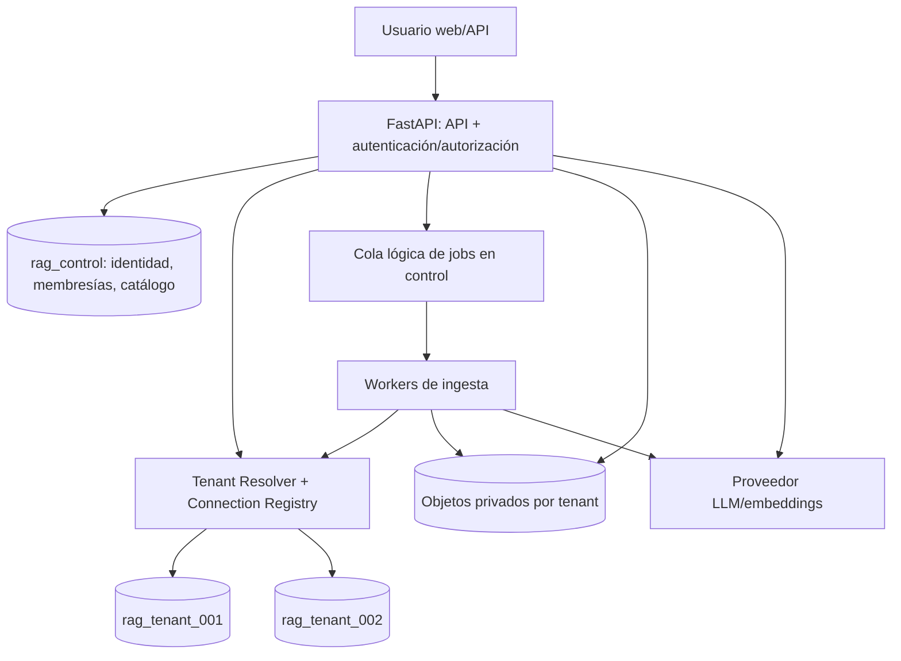

# 02 — Arquitectura lógica y física

## Vista de contexto



**Restricción:** el diagrama representa flujos autorizados de servicios; no existe una API que permita seleccionar libremente otra BD o ejecutar SQL sobre múltiples tenants.

## Plano de control: `rag_control`

- Catálogo de tenants, identidad global y membresías, referencia al destino PostgreSQL y al secreto del tenant, estado de aprovisionamiento, versiones de esquema, planes, límites, consumo agregado, registro mínimo de jobs y auditoría administrativa.
- **Prohibido:** texto completo de documentos privados, contenido de chunks, embeddings, historial de mensajes, prompts privados y credenciales en claro.
- Ubicaciones de almacenamiento guardadas como IDs/configuración no secreta.

## Plano de datos: base separada por tenant

- Esquemas iniciales orientativos: `knowledge` (repositorios, fuentes, documentos/versiones, chunks, embedding spaces), `assistant` (asistentes, enlaces repo), `conversation` (sesiones, mensajes, citas), `security` (ACL), `ops` (eventos locales/versionado).
- Un contrato de esquema común y migraciones coordinadas; cada base mantiene su versión y estado.
- Relaciones con usuario global por UUID lógico: no hay foreign keys entre BD central y BD tenant; se validan invariantes en servicios y pruebas.

## Componentes de código propuestos

```text
src/rag_platform/
  api/                 # HTTP, middleware, validación, control de acceso
  control/             # tenants, membresías, catálogo, medición
  tenancy/             # resolver, factory de conexiones, límites de pools
  repositories/        # catálogo documental y ACL dentro de tenant
  ingestion/           # parsers, normalización, versiones, jobs
  embeddings/          # adaptadores y spaces
  retrieval/           # búsqueda híbrida, filtros, reranking
  assistants/          # definición, fuentes autorizadas, prompt policy
  conversations/       # estados y mensajes
  providers/           # LLM, storage, identidad
  observability/       # logs, eventos, métricas
  common/              # tipos, errores, utilidades compartidas
migrations/{control,tenant}/
workers/
frontend/
ops/
tests/
```

No crear todos estos módulos vacíos en F00: esta es la estructura objetivo, materializada cuando corresponda.

## Flujo de consulta

1. Autenticar identidad y resolver membresía autorizada del tenant solicitado.
2. Resolver conexión del tenant (catálogo + referencia de secreto + pool limitado).
3. Verificar permiso del usuario para asistente y cada repositorio asociado.
4. Construir recuperación con filtro de repositorio y versiones publicadas; ejecutar búsqueda híbrida y reranking.
5. Construir contexto citando IDs estables de versiones/chunks y aplicar políticas de no divulgación.
6. Generar respuesta; validar citas y registrar evidencias/metadatos de uso en la BD del tenant.
7. Emitir métricas agregadas mínimas al control plane, sin texto de prompts o documentos.

## Flujo de ingesta

Solicitud autorizada -> objeto temporal privado -> registro de fuente/documento -> job durable sin payload sensible -> worker resuelve tenant -> extracción -> chunks -> embeddings -> validación -> publicación de versión -> auditoría y estados.

## Tecnología base y decisiones abiertas

- Python 3.12+ con FastAPI; SQLAlchemy/Alembic; PostgreSQL compatible con versión de pgvector adoptada; MinIO local/S3 en despliegues; UI web responsive.
- IdP OIDC configurable; Keycloak puede usarse como IdP local de pruebas, no obligación comercial.
- Cola durable inicial respaldada por PostgreSQL `rag_control`, con leasing/`SKIP LOCKED`; el transporte se abstrae para migrarlo después si el volumen lo requiere. Payload solo identificadores; no documentos ni secretos.
- Redis, GPU propia, Kafka, Kubernetes y n8n no son prerrequisitos del MVP.

## Fronteras de confianza

Internet/cliente -> API; API -> control; API/worker -> BD tenant; API/worker -> objetos tenant; API/worker -> proveedores externos. Cada salto exige autenticación, autorización y registros apropiados. Los documentos son **datos no confiables**, no instrucciones del sistema.
